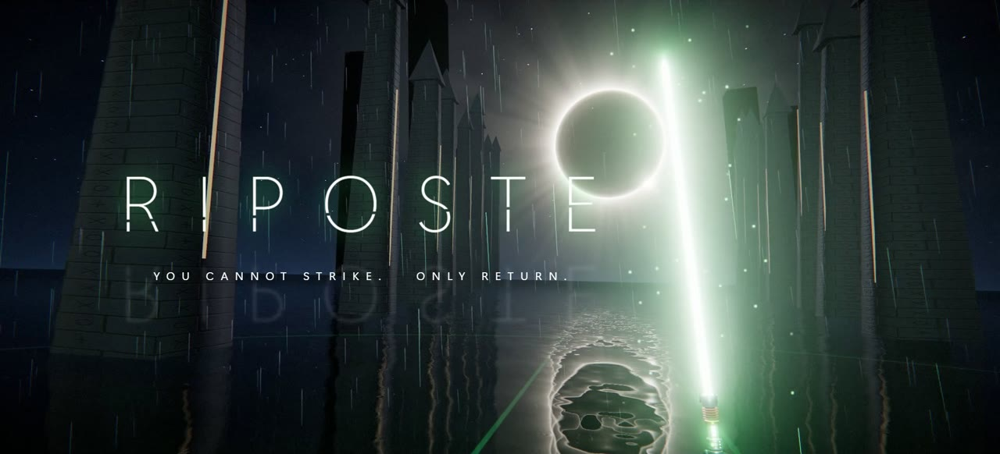
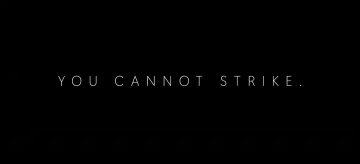
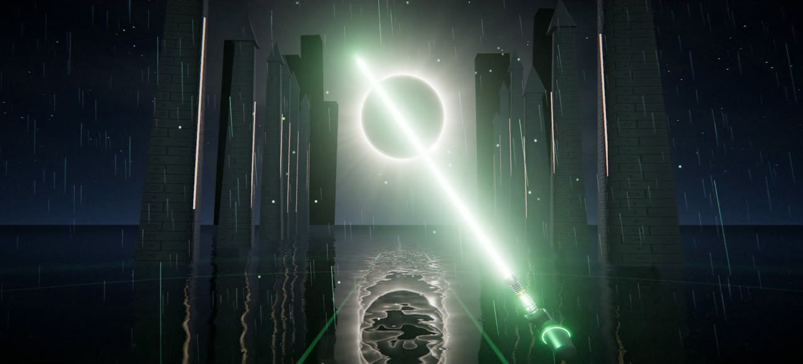
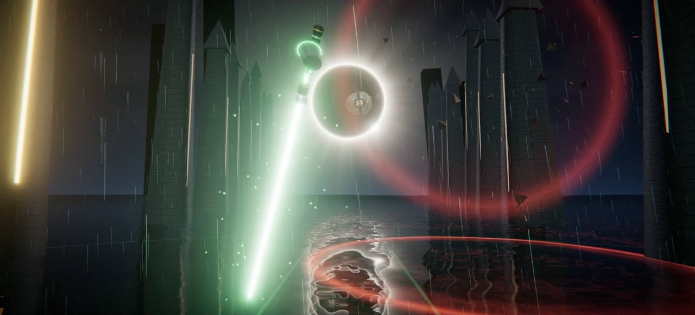
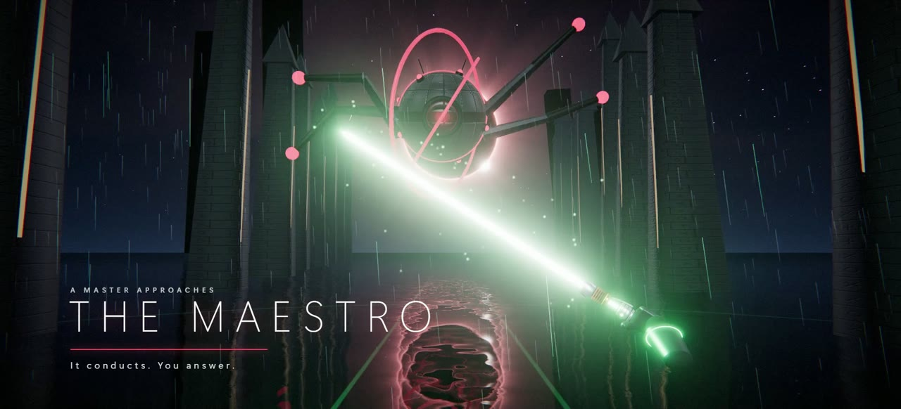
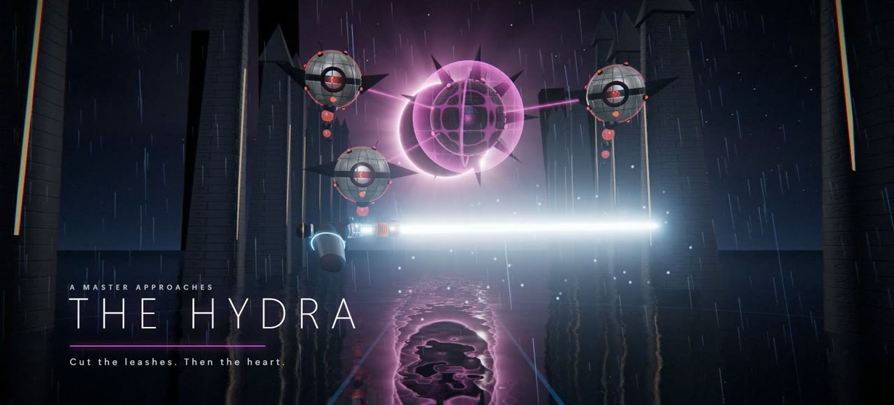
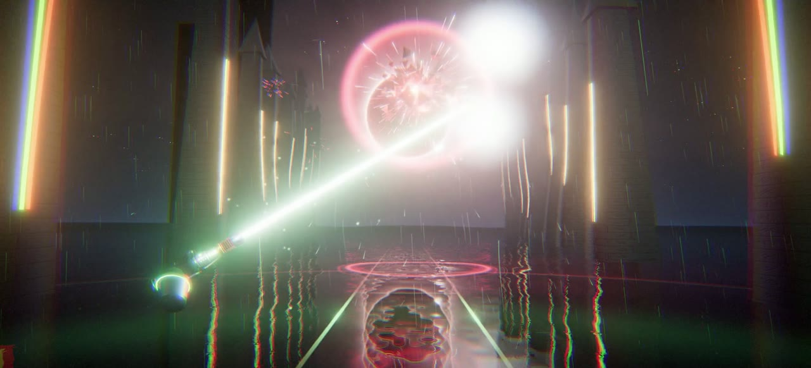
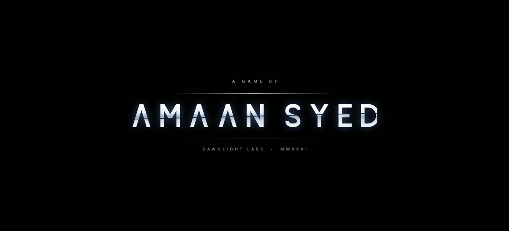

<div align="center">

<a href="https://riposte.amaansyed27.dev"></a>

# R I P O S T E

**You cannot strike. Only return.**

A browser game where you have no attack. Bolts come at you; put your blade in their path and they fly back at whoever fired them.

### [▶ &nbsp;Play it now](https://riposte.amaansyed27.dev) &nbsp;·&nbsp; [🎬 &nbsp;Watch the trailer](https://riposte.amaansyed27.dev/trailer.mp4)

No install, no account, nothing to download. Desktop and mobile.

<a href="https://riposte.amaansyed27.dev/trailer.mp4"></a>

<sub>Twelve seconds from the trailer. Click it for the full 87, with sound.</sub>

</div>

---

## The idea

Every action game hands you a weapon. This one hands you an answer.

The orbs fire. A ring closes on the spot where each bolt will land. Have the blade there and the bolt turns around. Swing through it hard and it is a **riposte**: it goes back at double strength. That is the whole verb. Everything else in the game is built to make that one moment feel good.

<table>
<tr>
<td width="50%"></td>
<td width="50%"></td>
</tr>
<tr>
<td align="center"><sub>The blade has a full life: ignite, hum, clash, retract.</sub></td>
<td align="center"><sub>Deflection is physical. If the blade is in the bolt's path, it returns.</sub></td>
</tr>
</table>

## How it plays

- **Three guard.** A bolt that gets through costs one. Clear a bout and one comes back.
- **Tempo.** Every return fills it. When it is full, time bends and each return echoes to a second target.
- **Five blades.** Azure, Verdant, Violet, Ember, Blanc.
- **Ranks.** Novice to Légende. Your best score is kept, and a run in progress survives closing the tab.
- **It does not end.** Bouts get faster and denser until you fall. Then you look at your rank and press *Try again*.

### The masters

Every fourth bout, one of them comes down out of the eclipse. Then they come back harder.

<table>
<tr>
<td width="33%"></td>
<td width="33%"></td>
<td width="33%"></td>
</tr>
<tr>
<td align="center"><b>The Maestro</b><br><sub>It conducts. You answer.</sub></td>
<td align="center"><b>The Hydra</b><br><sub>Cut the leashes. Then the heart.</sub></td>
<td align="center"><b>The Bastion</b><br><sub>Only a hard swing cracks it.</sub></td>
</tr>
</table>

## Ways to hold the blade

| | How |
| --- | --- |
| **Mouse / touch** | Your pointer or finger is a point on the blade; the hilt trails behind it, so the blade leans the way you move. |
| **Your phone as the saber** | On the opening page choose *Use your phone as the saber*, scan the code, and hold the phone like a hilt. The blade follows the phone's long axis, so the grip does not matter. In menus the phone turns into a remote. |
| **Gamepad** | A stick aims, A confirms and sheathes, B goes back, Start pauses, the d-pad moves through menus. |
| **DualSense motion** | Settings → Controls → *Enable* (Chrome or Edge). Experimental. |
| **Keyboard** | Space sheathes and ignites · Esc pauses · M mutes · F fullscreen · arrows or WASD and Enter in menus |

The phone link is peer to peer. Only where the phone points, button presses and haptic cues cross it.

## Install it

It is a web app you can install. Use **Install app** on the opening page, or your browser's own install option. On iPhone or iPad: Share, then *Add to Home Screen*. Once installed it opens fullscreen and works offline.

## Under the hood

| | |
| --- | --- |
| **Picture** | [three.js](https://threejs.org) on WebGL 2. The court, the orbs, the hilt and every texture are generated in code. HDR bloom, a planar reflection for the flooded floor, rain, lightning, and a lens pass for shockwaves and film grain. |
| **Sound effects** | All synthesized live with the Web Audio API: the hum follows the blade's speed, every deflection climbs a scale with your streak. |
| **Score** | Adaptive. The game's state picks the piece; a smoothed intensity value brings its low, mid and high layers in and out; synthesized drums lock to the battle music's own beat. |
| **Phone link** | WebRTC through [PeerJS](https://peerjs.com), paired with a QR code. |
| **Build** | [Vite](https://vite.dev). No framework. The only asset files are the music and one font. |

Design decisions and the things that went wrong along the way are in [notes.md](notes.md).

### The trailer is the game filming itself

There is no screen recording in the trailer. A dev-only director ([`src/dev/trailer.js`](src/dev/trailer.js)) steps the real game one frame at a time with scripted cameras and saves each frame, so it is a true 60 fps on any machine. While it runs, every sound the game asks for is written to a tape; the tape is then replayed through the game's own audio engine offline, so the picture and the sound are the same events.

## Run it yourself

```bash
npm install
```

```bash
npm run dev
```

```bash
npm run build
```

## Credits



**Made by [Amaan Syed](https://github.com/amaansyed27)** at Dawnlight Labs, written with Claude (Fable 5.2).

**Score.** Built from four orchestral pieces by [Luis_Humanoide](https://pixabay.com/users/luis_humanoide-12661853/), used under the [Pixabay Content License](https://pixabay.com/service/license-summary/) and edited into loops (`public/audio`):

- [The Path of the Force](https://pixabay.com/music/main-title-the-path-of-the-force-inspired-by-star-wars-405335/) — `menu.mp3` (opening page and blade select)
- [Secrets of the Jedi](https://pixabay.com/music/main-title-secrets-of-the-jedi-inspired-by-star-wars-331637/) — `calm.mp3` (between bouts) and `theme.mp3` (a master falls)
- [Star Wars Style Battle Music](https://pixabay.com/music/main-title-star-wars-style-battle-music-148641/) — `battle.mp3`
- [Temple of the Dark Side](https://pixabay.com/music/main-title-temple-of-the-dark-side-cinematic-dark-choral-music-219925/) — `boss.mp3`

These audio files are not covered by this repository's code licence; they remain under the Pixabay Content License and must not be redistributed on their own.

**Type.** Azonix is used for the Dawnlight wordmark. Cinzel is used under the SIL Open Font License.

**Opening sequence.** The Dawnlight mark is Dawnlight Labs' own. The pixel critter on the "Built with Claude" card is a hand-drawn nod to Claude's mascot; this is not an Anthropic product and is not endorsed by Anthropic.

Not affiliated with or endorsed by any film or game franchise.
